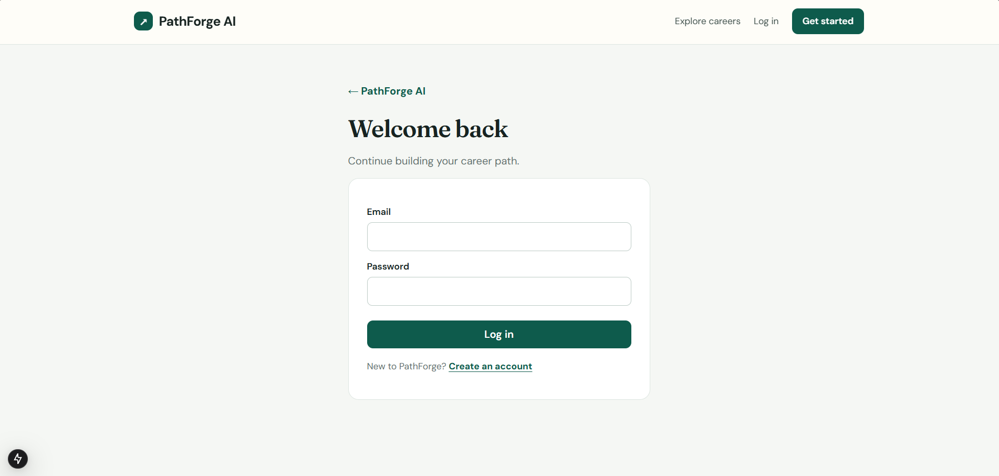
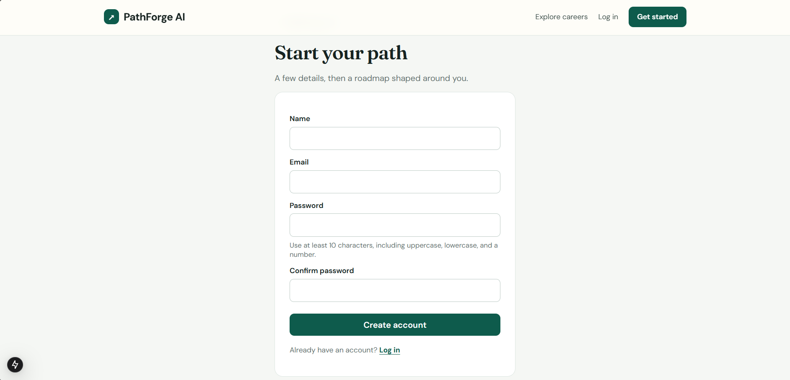
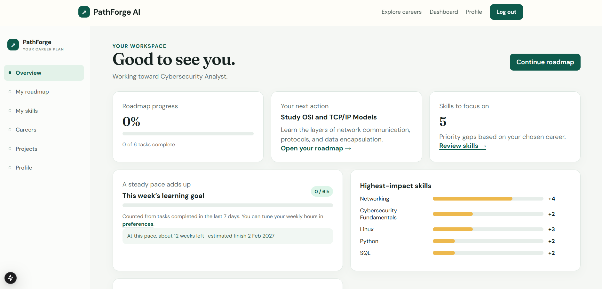
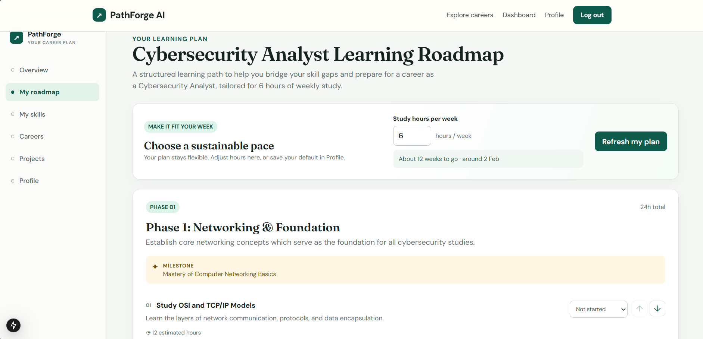
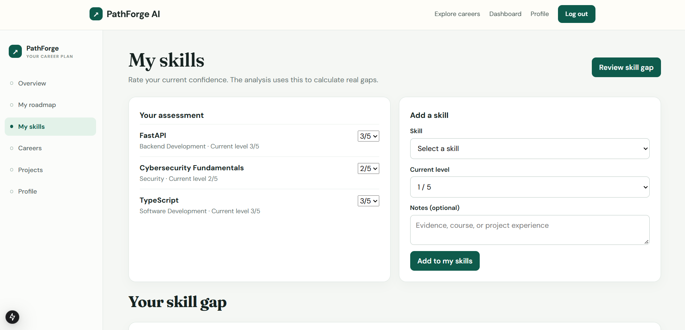
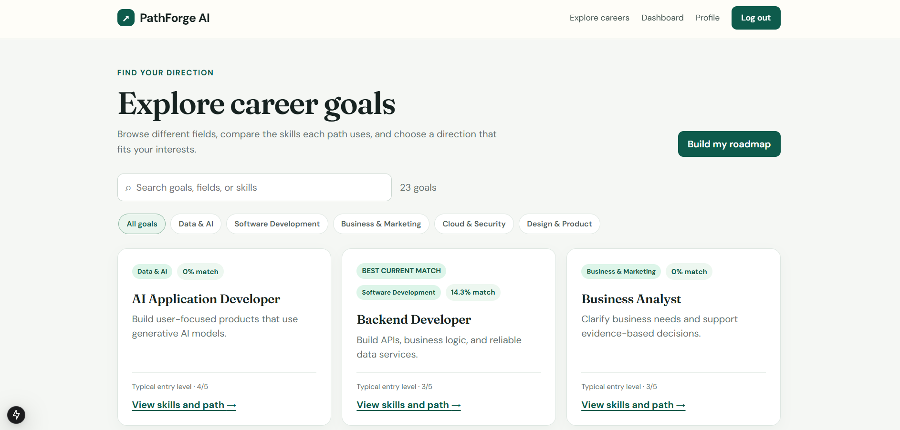
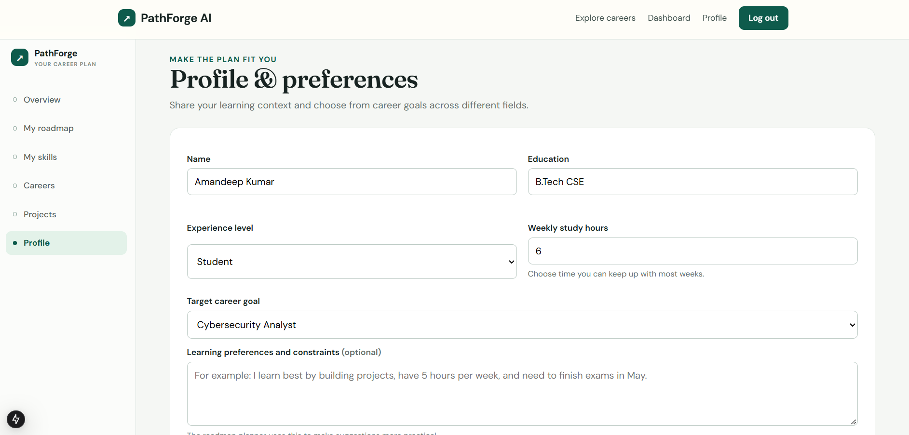

# PathForge AI

**Turn a career goal into a practical learning plan.** PathForge AI helps learners see which skills they need, what to learn first, and how to make steady progress toward a role.

PathForge combines a curated career and skill catalog with transparent, deterministic analysis. When a Gemini API key is configured, the app can use Gemini to personalize roadmap language and tasks. Generated content is validated against the app's schemas and career context before it is saved. Without an AI key, the deterministic local planner still creates a usable roadmap.

> PathForge is a planning and learning tool. Its career compatibility scores are based on the project's curated data and are not a guarantee of employment or a substitute for advice from a career counselor.

## Product screenshots

The following screenshots show the main learner journey: account access, onboarding, the dashboard, roadmap, skill assessment, career exploration, and profile preferences.

| Sign in | Create an account |
| --- | --- |
|  |  |

| Learner dashboard | Personalized roadmap |
| --- | --- |
|  |  |

| Skill assessment | Career explorer |
| --- | --- |
|  |  |

| Profile and preferences |
| --- |
|  |

## What it does

### A guided start

Create an account, set your education and experience context, choose a career goal, and add the hours you can study in a typical week. The dashboard makes the next setup step visible so a new learner can move from an empty profile into a useful plan.

### Career exploration

Browse a curated set of 23 career goals across software and mobile development, data and artificial intelligence, cybersecurity, design and product, and cloud and operations. Each career is mapped to the skills and proficiency levels used by the planner.

### Skill assessment and explainable gaps

Add skills to your profile, rate your current confidence on a five-level scale, and optionally record evidence such as a course, project, or work experience. PathForge compares those levels with the selected career's requirements and prioritizes the gaps using each skill's required level, importance, and relevance.

### Prerequisite-aware roadmaps

Create a roadmap for a selected career. The planner orders foundational skills before dependent skills, groups the work into phases and milestones, estimates task hours, and accounts for the learner's weekly study availability. Mark tasks complete as you go; dashboard and roadmap progress update from saved task state.

### Projects and learning resources

See project ideas matched to the target career and the learner's current skill gaps. The curated catalog also includes learning resources associated with relevant skills, so the learner can connect study to concrete practice.

### Optional Gemini personalization

When `GEMINI_API_KEY` is present on the backend, Gemini receives a bounded career and skill context and returns structured roadmap content. PathForge validates the result before writing it to the database. The model cannot directly modify records. If the key is absent, the request fails, or the provider response is invalid, the app uses its deterministic local planner and identifies that generation mode in the API data.

## How the recommendation works

The recommendation is built from structured records and inspectable rules rather than a black-box score:

1. Each career has required skills with a target proficiency, importance, and relevance.
2. The user's assessment is compared with those target levels. A skill not yet in the profile starts at level 0.
3. A positive difference is a skill gap. The priority signal is calculated as `gap × importance × relevance`.
4. The dependency graph orders prerequisite skills first. Cyclic prerequisite mappings are rejected rather than producing an ambiguous learning order.
5. Project recommendations are limited to projects associated with the selected career and ranked by their coverage of relevant skill gaps.
6. Roadmap hours and dashboard estimates use task estimates and the learner's selected weekly study hours.

Career compatibility is a relative estimate derived from assessed levels and the curated career requirements. It should be read as a learning-planning aid, not as a hiring probability.

## Main user journey

1. **Register or log in.** Create a learner account.
2. **Set your profile.** Add education, experience level, weekly study hours, constraints, and a target career.
3. **Record current skills.** Choose skills, set a level from 1 to 5, and optionally add evidence notes.
4. **Review gaps.** See prioritized differences between the profile and the career's requirements.
5. **Generate a roadmap.** Receive an ordered plan with phases, milestones, tasks, and time estimates.
6. **Keep moving.** Update task progress, check suggested projects, and adjust the profile or study availability when circumstances change.

## Screens and navigation

- **Home:** overview of the planning workflow and links to sign-up and career exploration.
- **Careers:** searchable career catalog and individual career details.
- **Overview:** setup checklist, target career, roadmap progress, next task, priority gaps, study pace, and project suggestions.
- **My roadmap:** roadmap phases, milestones, task details, estimates, and progress controls.
- **My skills:** current assessments, confidence levels, evidence notes, and skill entry.
- **Projects:** practical project recommendations connected to skills and career goals.
- **Profile:** learner context, target career, weekly hours, and planning constraints.

## Architecture

```text
Browser
  └── Next.js 15 / React 19 / TypeScript
        └── JSON REST API
              └── FastAPI modular monolith
                    ├── Authentication and profile endpoints
                    ├── Career catalog and skill-gap services
                    ├── Prerequisite and project recommendation logic
                    ├── Roadmap provider interface
                    │     ├── Gemini structured generation (optional)
                    │     └── Deterministic local planner (fallback)
                    └── SQLAlchemy 2 / Alembic
                          └── PostgreSQL 16
```

The API owns validation, authorization, business rules, and persistence. PostgreSQL stores users, profiles, skill assessments, career mappings, prerequisites, projects, learning resources, roadmaps, task progress, and AI generation logs. Alembic migrations track schema changes. The frontend calls the API through a typed client and includes protected workspace routes.

## Technology stack

| Area | Technologies |
| --- | --- |
| Web application | Next.js 15, React 19, TypeScript, responsive CSS |
| API | Python 3.11+, FastAPI, Pydantic, Uvicorn |
| Data access | SQLAlchemy 2, Alembic, psycopg 3 |
| Database | PostgreSQL 16 |
| Optional AI | Gemini `generateContent` structured JSON response mode |
| Local orchestration | Docker Compose |
| Automated checks | Pytest, Ruff, TypeScript, ESLint, Next.js production build |

## Run locally with Docker Compose

### Requirements

- Docker Desktop with Docker Compose v2
- A Gemini API key only if Gemini personalization is needed; local deterministic roadmaps work without it

From the repository root in PowerShell:

```powershell
Copy-Item .env.example .env
```

Open `.env` and set a unique `POSTGRES_PASSWORD` and `JWT_SECRET` (at least 32 random characters). `GEMINI_API_KEY` is optional for local use. Then start the stack:

```powershell
docker compose up --build -d
```

Open the app at [http://localhost:3000](http://localhost:3000). The API health check is [http://localhost:8000/health](http://localhost:8000/health), and interactive API documentation is at [http://localhost:8000/docs](http://localhost:8000/docs).

Useful commands:

```powershell
docker compose ps
docker compose logs -f backend frontend
docker compose down
```

`docker compose down` keeps the database volume. To delete the local development database volume and its data, run `docker compose down -v`.

## Run locally without Docker

### Requirements

- Python 3.11 or later
- Node.js 20 or later
- PostgreSQL 15 or later

Create the root `.env` file from `.env.example`, configure a local PostgreSQL database and a unique `JWT_SECRET`, then start the backend:

```powershell
cd backend
python -m venv .venv
.\.venv\Scripts\Activate.ps1
python -m pip install -e ".[dev]"
alembic upgrade head
python scripts/seed.py
uvicorn app.main:app --reload --port 8000
```

In a second terminal, start the frontend:

```powershell
cd frontend
Copy-Item .env.local.example .env.local
npm install
npm run dev
```

Visit `http://localhost:3000`. The default API base is `http://localhost:8000/api/v1`. The root `.env` configures the backend. `frontend/.env.local` configures the public API URL used when building or running the Next.js application.

## Configuration

| Variable | Required | Purpose |
| --- | --- | --- |
| `DATABASE_URL` | Yes | SQLAlchemy database URL; production must use PostgreSQL. |
| `JWT_SECRET` | Yes | Private signing secret; use a unique random value of at least 32 characters. |
| `FRONTEND_ORIGIN` | Yes for deployed use | Exact browser origin allowed by CORS and request-origin checks. |
| `GEMINI_API_KEY` | No | Enables Gemini roadmap personalization. Keep it only in the backend's secret store. |
| `GEMINI_MODEL` | No | Gemini model name; project default is `gemini-3.5-flash-lite`. |
| `AI_TIMEOUT_SECONDS` | No | Maximum provider request duration; default is 30 seconds. |
| `ACCESS_TOKEN_MINUTES` | No | Access-token lifetime; default is 15 minutes. |
| `REFRESH_TOKEN_DAYS` | No | Refresh-session lifetime; default is 14 days. |
| `NEXT_PUBLIC_API_URL` | No | Frontend API base, ending in `/api/v1`; defaults to the local API. |
| `PORT` | Set by host | Port for the API container; defaults to 8000 locally. |

See `.env.example` and `frontend/.env.local.example` for the full local templates. Never commit `.env`, `.env.local`, API keys, production database URLs, or real user data.

## Deploy with Render

The root [`render.yaml`](render.yaml) describes three services in the Singapore region: a Next.js web service, a FastAPI API service, and managed PostgreSQL. It selects persistent, always-on plans. The Blueprint generates `JWT_SECRET` and prompts for `GEMINI_API_KEY` as a secret during initial setup.

1. Push this repository to a private GitHub repository.
2. In Render, create a new Blueprint and select the repository.
3. Review the services, regions, health checks, database storage, and the estimated recurring charge.
4. Enter the Gemini API key only in Render's secret field if Gemini is to be enabled.
5. Apply the Blueprint and wait for the frontend and API health checks to pass.

The web service's `NEXT_PUBLIC_API_URL`, API `FRONTEND_ORIGIN`, database URL, and health-check paths are defined in the Blueprint. For a custom domain, update the origin and API URL to the deployed domains and redeploy. Keep the database private and use TLS for all public traffic.

## API overview

All application endpoints use the `/api/v1` prefix. Interactive OpenAPI documentation is available at `/docs` when the backend is running. Route groups include:

- Authentication and refresh-session handling
- Learner profile and skill assessments
- Careers, career skill requirements, gap reports, and career recommendations
- Roadmap generation, roadmap retrieval, phases, tasks, and task progress
- Projects, career-matched project recommendations, and learning resources
- Dashboard summaries and study progress
- Administrator-only catalog management for skills, careers, mappings, prerequisites, projects, and resources

Successful responses use a consistent `{ "success": true, "data": ... }` envelope. Errors use `{ "success": false, "error": ... }` with an application error code and message. Refer to [docs/API_SPECIFICATION.md](docs/API_SPECIFICATION.md) for the current endpoint contract.

## Database and seed data

The initial Alembic migrations create the relational schema for accounts, profiles, refresh sessions, careers, skills, prerequisites, projects, learning resources, roadmaps, milestones, tasks, progress, and AI generation logs. Apply changes with:

```powershell
cd backend
alembic upgrade head
```

Seed or update the curated catalog with:

```powershell
python scripts/seed.py
```

Seeding is designed to be safe to rerun; it adds or updates catalog records without deleting learner records. The repository currently seeds 23 target career goals, related skill maps, project recommendations, and learning resources. See [docs/DATABASE_DESIGN.md](docs/DATABASE_DESIGN.md) and [docs/TECHNICAL_DECISIONS.md](docs/TECHNICAL_DECISIONS.md).

To grant administrator access, register the account first, then run this from `backend` against the configured database:

```powershell
python scripts/promote_admin.py learner@example.com
```

Protect this operation and all admin credentials in production. Do not grant administrator access to ordinary learner accounts.

## Security and data handling

- Passwords are stored as hashes; authentication uses signed access and refresh tokens.
- Protected API operations require an authenticated account; catalog management requires administrator access.
- Production configuration rejects weak signing secrets, insecure frontend origins, and non-PostgreSQL databases.
- Gemini credentials are backend-only and must never use a `NEXT_PUBLIC_` variable.
- AI input is limited to the structured context needed for a plan; generated output is schema-checked and business-validated before persistence.
- The AI provider does not receive database write access.
- Configure a strong unique `JWT_SECRET`, restricted database credentials, HTTPS, backups, and appropriate privacy notices before opening a production service to public users.

## Quality checks

Run the backend checks from `backend`:

```powershell
python -m ruff check app tests
python -m pytest -q
```

Run frontend checks from `frontend`:

```powershell
npm run typecheck
npm run lint
npm run build
```

The backend suite uses an isolated SQLite database for repeatable API and service checks. A separate PostgreSQL integration run and a live Gemini request require those services and credentials to be configured. For the feature-by-feature status and known verification boundaries, see [docs/IMPLEMENTATION_STATUS.md](docs/IMPLEMENTATION_STATUS.md) and [docs/TESTING_QA.md](docs/TESTING_QA.md).

## Repository map

```text
backend/
  app/                  FastAPI routes, schemas, models, auth, services
  migrations/           Alembic configuration and schema revisions
  scripts/              Catalog seeding and administrator promotion
  tests/                Backend API and service tests
frontend/
  app/                  Next.js pages and responsive design
  components/           Shared navigation, application shell, route protection
  lib/                  Typed API client and session handling
docs/                   Requirements, architecture, API, UX, data, testing
database/               Database operations notes
render.yaml             Render service and database Blueprint
docker-compose.yml      Local multi-service development stack
```

## Project documentation

- [Project overview](docs/PROJECT_OVERVIEW.md)
- [Software requirements](docs/SRS.md)
- [System design](docs/SYSTEM_DESIGN.md)
- [Database design](docs/DATABASE_DESIGN.md)
- [AI/ML design](docs/AI_ML_DESIGN.md)
- [API specification](docs/API_SPECIFICATION.md)
- [UI/UX specification](docs/UI_UX_SPECIFICATION.md)
- [Implementation plan](docs/IMPLEMENTATION_PLAN.md)
- [Implementation status](docs/IMPLEMENTATION_STATUS.md)
- [Testing and QA](docs/TESTING_QA.md)
- [Technical decisions](docs/TECHNICAL_DECISIONS.md)

## License

No open-source license is currently included. Unless the repository owner adds a license, the source remains subject to the rights reserved by its copyright holder.

